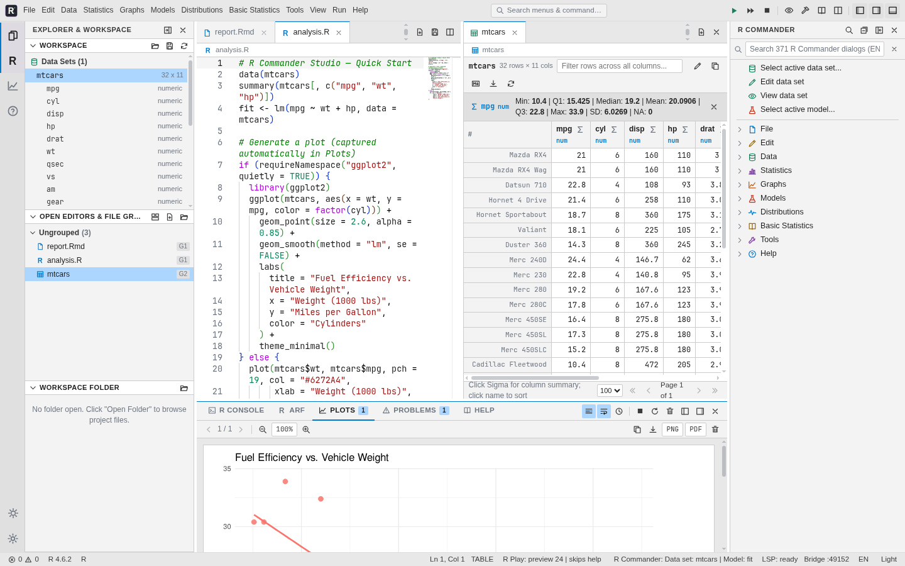

<p align="center">
  
</p>

<p align="center">
  
  
  
  
  
  
</p>

<p align="center">
  <code>.R</code> · <code>.Rmd</code> · <code>.qmd</code> · <code>.md</code> · <code>.RData / .rda / .rds</code> · <code>.csv / .tsv</code> · <code>Monaco Editor</code> · <code>R LSP + Hover Docs</code> · <code>arf &amp; R Terminals</code> · <code>Markdown Viewer</code> · <code>NoteComplete Bridge</code>
</p>

# R Commander Studio

**A lightweight, VS Code-style R and R Markdown IDE with all 371 bilingual R Commander dialogs, interactive Data Viewer, NoteComplete-grade Markdown Viewer, `arf` and `R` terminals, and a local NoteComplete Bridge.**

Evolved from **[`r-commander-in-vscode`](https://github.com/Emefedez/r-commander-in-vscode)** by **[Emefedez](https://github.com/Emefedez)** into a standalone cross-platform desktop application built on Electron and offline Monaco Editor with a native **Dracula** default palette (plus 7 additional dark and light presets and a live Theme Editor). Runs standalone (portable or installed) or as a zero-bloat companion to **[NoteComplete](https://github.com/Emefedez/NoteComplete)**.

---

## Screenshots

| Dracula IDE & R Commander Sidebar | Split Editor, Interactive Table Viewer & Plots |
| :---: | :---: |
|  |  |

| VS Code Light+ Theme | Bilingual R Commander Dialog (`ES` / `EN`) |
| :---: | :---: |
|  |  |

---

## Key Features

- **VS Code Workbench & Flexible Docking:**
  - Single `34px` top bar with full cascading R Commander menus, compact command search (`Ctrl+K` / `Ctrl+Shift+P`), instant **`ES` / `EN` language toggle** right beside the Run buttons, and uniform icon-only SVG action buttons (zero emojis).
  - **Two independent, collapsible, draggable sidebars** (**Explorer & Workspace** and **R Commander**): dock both on the Left (side by side), one Left and one Right, or both on the Right.
  - **Hover-to-peek closed sidebars:** hover a collapsed sidebar's edge rail to slide it open; choosing a file, dataset, or command jumps straight there and auto-closes it.
  - **Dockable Bottom / Side Panel** with horizontal or vertical tabs for **R Console**, **`arf` Terminal**, **Plots**, **Problems**, and **Help**.
- **Complete Bilingual `r-commander-in-vscode` Parity (`Español` & `English`) + Cross-Language Function Search:**
  - All **371 R Commander & TeachStat commands** with colored Codicon tree, top menu bar, and form/step dialogs (`Reset`, `Cancel`, `Insert`, `Run`, `Run & Insert`).
  - **Language-independent search:** search any statistical test, menu item, or R function in **Spanish**, **English**, or by **R function name** (e.g. `regresión lineal`, `linear regression`, `lm`, `t.test`, `shapiro.test`) regardless of which interface language is currently active.
  - All 15 `r-commander-in-vscode` execution options: **Limit Long Output** (`24` items preview), **Skip Help (`?` / `help`)**, custom skipped commands, **Fixed Notation** (no `1e-05`), **Syntax Colors**, **Word Wrap ON by default**, scrollable output blocks, and permanent CRAN package cache.
- **Hover `⋯` Actions on Generated R & `arf` Output:**
  - Hovering any generated output block in **R Console** or **`arf` Terminal** reveals a top-right **`⋯`** menu to:
    - **Copy Output** or **Copy Command + Output as Markdown**.
    - **Open Output in New Window** (dedicated pop-out viewer window with print/PDF export).
    - **Paste into Document** — choose between **Currently Open Document**, **Document in This Workspace…**, or **New Document**.
- **Rich Markdown & R Markdown Viewer (from NoteComplete):**
  - Split or Full-Screen Markdown Viewer (`Ctrl+Shift+V`) with YAML frontmatter cards, GitHub-style heading anchors and interactive Outline/TOC bar, GFM callouts (`[!NOTE]`, `[!TIP]`, `[!IMPORTANT]`, `[!WARNING]`, `[!CAUTION]`), task lists, aligned tables, syntax-highlighted code blocks, inline & display LaTeX math (`$...$`, `$$...$$`), one-click **Run `{r}` Chunk**, and **Open Viewer in New Window**.
- **Monaco Editor, R LSP Diagnostics & Rich Hover Docs (`F1`):**
  - Offline Monaco Editor for `.R`, `.Rmd` (YAML + Markdown + fenced `{r}` chunks), `.md`, and `.csv`, with split editor groups and named **File Groups**.
  - Live syntax diagnostics from R `languageserver` + instant `Rscript parse()` fallback mapped to exact `.R` and `.Rmd` lines.
  - Hovering any R function displays its signature, arguments, description, concise `\examples`, clickable R Commander menu paths, and one-click **Open R Docs (`?fn`)**.
- **`.RData` Workspace & Interactive Table Viewer:**
  - Load and save `.RData`, `.rda`, `.rds`, and `.csv`/`.tsv` files from menus, Explorer, or drag-and-drop.
  - Calling `View(df)` in R or clicking any data frame opens an interactive **Table Viewer** tab with sorting, live filtering, pagination, column `Σ` summary stats (`min`, `Q1`, `median`, `mean`, `Q3`, `max`, `SD`, `NA`, factor levels), cell editing, and CSV/Markdown export.
- **Plot Viewer, 8 Themes & GitHub Auto-Updater:**
  - Automatic vector SVG plot capture (`svglite` or `grDevices::svg`) with plot history, zoom, and **SVG / PNG / PDF / Clipboard** export.
  - **8 Built-in Themes** (Dracula default, VS Code Dark+, One Dark Pro, Nord, Tokyo Night, VS Code Light+, NoteComplete Light, Solarized Light) + live Theme Editor.
  - Built-in **GitHub Releases Auto-Updater** (`Help → Check for Updates…`) with `SHA256SUMS.txt` verification.

---

## Keyboard Shortcuts

| Shortcut | Action |
| :--- | :--- |
| `Ctrl+Enter` / `Cmd+Enter` | Run selection or current line and advance cursor |
| `Alt+Enter` | Run selection or current line and keep cursor in place |
| `Ctrl+Shift+Enter` | Run active `{r}` chunk (in `.Rmd`) or entire script (in `.R`) |
| `Ctrl+Alt+P` / `Ctrl+Alt+E` | Run all chunks above cursor / Run from cursor line to end |
| `Alt+-` / `Ctrl+Shift+M` | Insert R assignment ` <- ` / pipe ` \|> ` |
| `Ctrl+Shift+K` / `Ctrl+Shift+V` | Knit R Markdown to HTML / Toggle Markdown Viewer |
| `F1` | Open R documentation (`?fn`) for function under cursor |
| `Ctrl+K` / `Ctrl+Shift+P` | Open Command & R Commander Menu Palette |
| `Ctrl+B` / `Ctrl+Alt+I` / `Ctrl+J` | Toggle Explorer sidebar / R Commander sidebar / Terminal panel |
| `Ctrl+\` / `Alt+Z` | Split editor side by side / Toggle word wrap |
| `Ctrl++` / `Ctrl+-` / `Ctrl+0` | Zoom in / Zoom out / Reset zoom |

---

## Portable & Installer Builds

Every release ships **both self-contained portable builds and system installers** containing the entire featureset (offline Monaco Editor, all 371 R Commander dialogs, R runner, Markdown Viewer, and NoteComplete Bridge):

```bash
npm install
npm start                # Launch R Commander Studio from source
npm test                 # Run automated test suite
npm run install-desktop  # Install desktop launcher & R file associations on Linux
```

| Platform | Command | Portable & Installer Outputs in `dist/` |
| :--- | :--- | :--- |
| **Linux x86_64** | `npm run dist:linux:x64` | `R Commander Studio-0.1.0-linux-x86_64.AppImage` (Portable) & `.tar.gz` (Portable archive) |
| **Linux ARM64** | `npm run dist:linux:arm64` | `R Commander Studio-0.1.0-linux-arm64.AppImage` (Portable) & `.tar.gz` (Portable archive) |
| **Windows x64** | `npm run dist:win` | `R Commander Studio-0.1.0-win-x64-setup.exe` (NSIS Installer), `-portable.exe` & `.zip` (Portable) |
| **macOS ARM64** | `npm run dist:mac` | `R Commander Studio-0.1.0-mac-arm64.dmg` (Installer) & `.zip` (Portable `.app`) |

On Linux, launching the `.AppImage` or choosing **Help → Install Desktop Shortcut & File Associations** automatically registers `R Commander Studio` in your application launcher and associates `.R`, `.Rmd`, `.qmd`, `.RData`, `.rda`, and `.rds` files.

On macOS the app is ad-hoc signed but not notarized (no Apple Developer ID yet), so the first launch is blocked as coming from an unidentified developer. Open it once via **System Settings → Privacy & Security → Open Anyway**, or run `xattr -dr com.apple.quarantine "/Applications/R Commander Studio.app"`.

---

## Related Projects

- **[`r-commander-in-vscode`](https://github.com/Emefedez/r-commander-in-vscode)** — The original VS Code extension by **[Emefedez](https://github.com/Emefedez)** that inspired R Commander Studio (green Run button with visible R output and R Commander menus, forms, tree, and hover docs inside VS Code).
- **[NoteComplete](https://github.com/Emefedez/NoteComplete)** — Local-first note reader and study environment with a zero-bloat local bridge to R Commander Studio.
