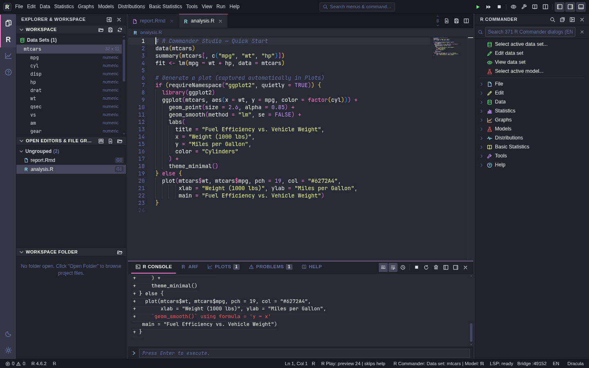
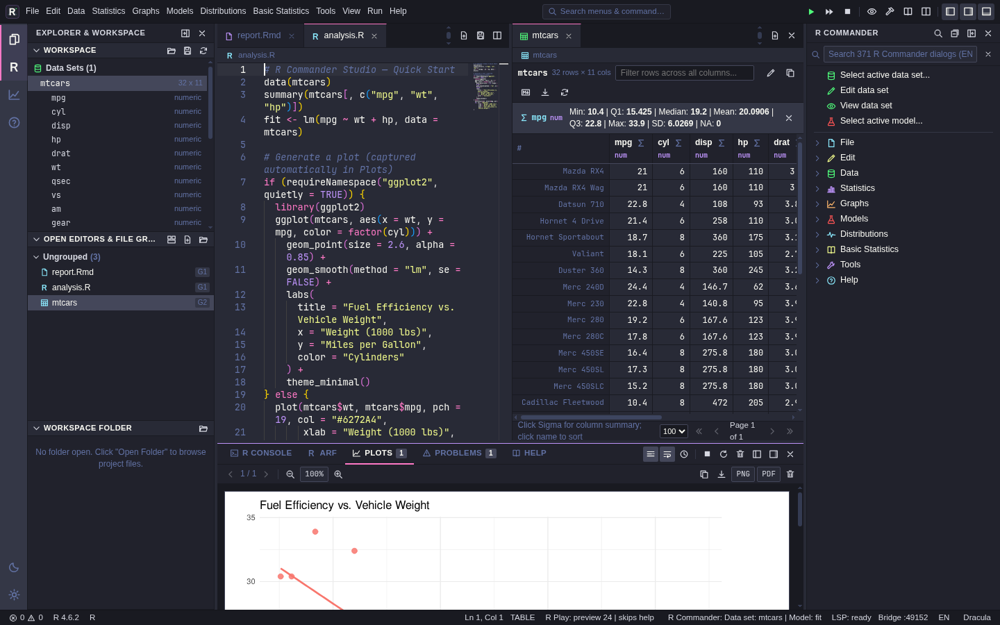
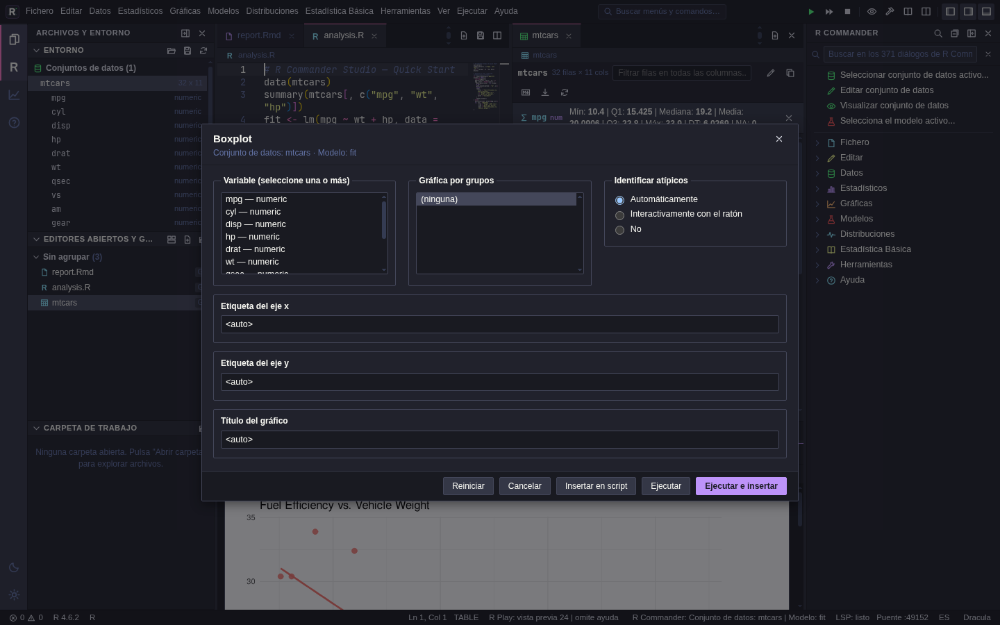

<p align="center">
  
</p>

<p align="center">
  
  
  
  
  
  
</p>

<p align="center">
  <code>.R</code> · <code>.Rmd</code> · <code>.qmd</code> · <code>.RData / .rda / .rds</code> · <code>.csv / .tsv</code> · <code>Monaco Editor</code> · <code>R LSP + Hover Docs</code> · <code>arf &amp; R Terminals</code> · <code>NoteComplete Bridge</code>
</p>

# R Commander Studio

**A lightweight, VS Code-style R and R Markdown IDE with all 371 bilingual R Commander dialogs, interactive Data Viewer, `arf` and `R` terminals, and a local NoteComplete Bridge.**

Built on Electron and offline Monaco Editor with a native **Dracula** default palette (plus 7 additional dark and light presets and a live Theme Editor). Runs standalone or as a companion to **NoteComplete**.

---

## Screenshots

| Dracula IDE & R Commander Sidebar | Split Editor, Interactive Table Viewer & Plots |
| :---: | :---: |
|  |  |

| VS Code Light+ Theme | Bilingual R Commander Dialog (`ES` / `EN`) |
| :---: | :---: |
|  |  |

---

## Key Features

- **VS Code Workbench & Flexible Docking:**
  - Single `34px` top bar with full cascading R Commander menus, compact command search (`Ctrl+K` / `Ctrl+Shift+P`), and uniform icon-only SVG action buttons (zero emojis).
  - **Two independent, collapsible, draggable sidebars** (**Explorer & Workspace** and **R Commander**): dock both on the Left (side by side), one Left and one Right, or both on the Right.
  - **Hover-to-peek closed sidebars:** hover a collapsed sidebar's edge rail to slide it open; choosing a file, dataset, or command jumps straight there and auto-closes it.
  - **Dockable Bottom / Side Panel** with horizontal or vertical tabs for **R Console**, **`arf` Terminal**, **Plots**, **Problems**, and **Help**.
- **Complete Bilingual `r-commander-play` Parity (`Español` & `English`):**
  - All **371 R Commander & TeachStat commands** with instant accent-folded search, colored Codicon tree, top menu bar, and form/step dialogs (`Reset`, `Cancel`, `Insert`, `Run`, `Run & Insert`).
  - All 15 `r-commander-play` execution options: **Limit Long Output** (`24` items preview), **Skip Help (`?` / `help`)**, custom skipped commands, **Fixed Notation** (no `1e-05`), **Syntax Colors**, **Word Wrap ON by default**, scrollable output blocks, and permanent CRAN package cache.
- **Monaco Editor, R LSP Diagnostics & Rich Hover Docs:**
  - Offline Monaco Editor for `.R`, `.Rmd` (YAML + Markdown + fenced `{r}` chunks), `.md`, and `.csv`, with split editor groups and named **File Groups**.
  - Live syntax diagnostics from R `languageserver` + instant `Rscript parse()` fallback mapped to exact `.R` and `.Rmd` lines.
  - **Hover & Signature Help (`F1`):** hovering any R function displays its signature, arguments, description, concise `\examples`, clickable R Commander menu paths, and one-click **Open R Docs (`?fn`)**.
- **`.RData` Workspace & Interactive Table Viewer:**
  - Load and save `.RData`, `.rda`, `.rds`, and `.csv`/`.tsv` files from menus, Explorer, or drag-and-drop.
  - Calling `View(df)` in R or clicking any data frame opens an interactive **Table Viewer** tab with sorting, live filtering, pagination, column `Σ` summary stats (`min`, `Q1`, `median`, `mean`, `Q3`, `max`, `SD`, `NA`, factor levels), cell editing, and CSV/Markdown export.
- **Plot Viewer & Exports:**
  - Automatic vector SVG plot capture (`svglite` or `grDevices::svg`) for base R, `ggplot2`, `car`, `RcmdrMisc`, and `lattice` with plot history, zoom, and **SVG / PNG / PDF / Clipboard** export.
- **8 Built-in Themes + Live Theme Editor:**
  - **Dark:** Dracula (default), VS Code Dark+, One Dark Pro, Nord, Tokyo Night.
  - **Light:** VS Code Light+, NoteComplete Light, Solarized Light — plus live per-token hex/color pickers and JSON import/export in Settings.

---

## Keyboard Shortcuts

| Shortcut | Action |
| :--- | :--- |
| `Ctrl+Enter` / `Cmd+Enter` | Run selection or current line and advance cursor |
| `Alt+Enter` | Run selection or current line and keep cursor in place |
| `Ctrl+Shift+Enter` | Run active `{r}` chunk (in `.Rmd`) or entire script (in `.R`) |
| `Ctrl+Alt+P` / `Ctrl+Alt+E` | Run all chunks above cursor / Run from cursor line to end |
| `Alt+-` / `Ctrl+Shift+M` | Insert R assignment ` <- ` / pipe ` \|> ` |
| `Ctrl+Shift+K` / `Ctrl+Shift+V` | Knit R Markdown to HTML / Toggle live preview |
| `F1` | Open R documentation (`?fn`) for function under cursor |
| `Ctrl+K` / `Ctrl+Shift+P` | Open Command & R Commander Menu Palette |
| `Ctrl+B` / `Ctrl+Alt+I` / `Ctrl+J` | Toggle Explorer sidebar / R Commander sidebar / Terminal panel |
| `Ctrl+\` / `Alt+Z` | Split editor side by side / Toggle word wrap |
| `Ctrl++` / `Ctrl+-` / `Ctrl+0` | Zoom in / Zoom out / Reset zoom |

---

## Quick Start & Packaging

```bash
npm install
npm start          # Launch R Commander Studio
npm test           # Run automated test suite (21 tests)
```

### Build Installers / Executables

| Platform | Command | Output in `dist/` |
| :--- | :--- | :--- |
| **Linux x86_64** | `npm run dist:linux:x64` | `R Commander Studio-0.1.0-linux-x86_64.AppImage` |
| **Linux ARM64** | `npm run dist:linux:arm64` | `R Commander Studio-0.1.0-linux-arm64.AppImage` |
| **Windows x64** | `npm run dist:win` | `R Commander Studio-0.1.0-win-x64.exe` (NSIS + Portable) |
| **macOS ARM64** | `npm run dist:mac` | `R Commander Studio-0.1.0-mac-arm64.dmg` & `.zip` |

GitHub Actions (`.github/workflows/release.yml`) automatically builds all four targets and generates `SHA256SUMS.txt` on release tags (`v*`).

---

## NoteComplete Integration

When running alongside **NoteComplete**, R Commander Studio writes a local-only discovery file (`~/.config/notecomplete/r-bridge.json`, mode `0600`) and serves a Bearer-authenticated loopback API on `127.0.0.1` (`/health`, `/catalog`, `/eval-figure`, `/eval-code`, `/open-script`, `/open-path`). NoteComplete can automatically download and install the matching platform build, create single `.R`/`.Rmd` files or full R Workspace folders from **File → New note…**, and open `.R`, `.Rmd`, `.qmd`, and `.RData`/`.rds` files directly.
